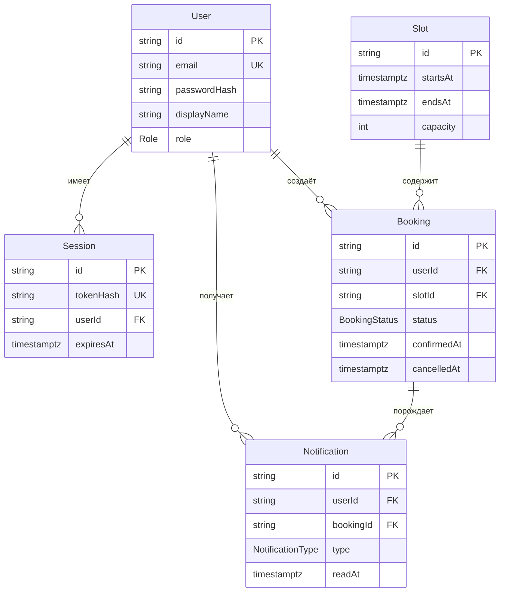

# mini-booking-system — спецификация auth-контура и слоя данных

## Краткое описание

`mini-booking-system` — учебный сервис записей (booking) на Next.js 16 App Router. Документ фиксирует два связанных фрагмента:

- **4.3.2 auth-lite** — регистрация, вход, серверная сессия в базе данных, страница аккаунта и серверные проверки ролей;
- **4.3.3 data layer** — модели `Slot`, `Booking`, `Notification`, статусы брони, серверные инварианты, seed слотов и модули доступа к данным.

Матрица ролей из раздела «Пользователи и роли» — обязательная часть этого документа.

Пользовательский booking flow (страницы слотов, формы создания/переноса/отмены брони, экран уведомлений), административная панель и внешние уведомления в объём фазы 4.3.3 не входят: слой данных готовит для них серверную основу.

## Проблема и цель

**Проблема.** В проекте нет пользователей и сессий: единственная страница `app/page.tsx` — стартовый экран, моделей данных и auth-логики нет. Пока нет аутентификации, нельзя ни завести записи, ни показать уведомления, ни разграничить доступ между ролями.

**Проблема слоя данных.** После auth-контура есть пользователи и сессии, но нет предметных данных: слотов, броней и уведомлений. Без них аккаунт остаётся статическим макетом, а правила записи — непроверяемыми.

**Цель.** Собрать базовый auth-контур на собственном стеке проекта, без внешней auth-библиотеки, и зафиксировать, как в нём принимаются решения о доступе:

форма → Server Action → PostgreSQL через Prisma → сессия в базе данных → серверные проверки ролей.

**Цель слоя данных.** Описать и реализовать серверную основу записей: `Slot`, `Booking` и `Notification`, допустимые переходы статусов, проверку вместимости и владельца, идемпотентный seed слотов и модули доступа к данным. Пользовательский интерфейс booking flow остаётся на следующий этап.

**Критерий успеха.** Пользователь может создать учётную запись, войти, увидеть свой аккаунт и выйти; запрос к аккаунту без действующей сессии отклоняется; seed создаёт начальный аккаунт `super_admin`; роль `user` назначается регистрацией, а `admin` и `super_admin` — только вне публичного ввода. В слое данных пользователь может создать бронь только на свой будущий свободный слот, отменить только свою бронь и получить внутреннее уведомление; чужие брони и уведомления недоступны, а недопустимые переходы статусов отклоняются сервером.

## Пользователи и роли

`guest` — не роль в базе данных, а состояние запроса без действующей сессии. `user`, `admin`, `super_admin` — значения поля `User.role`; это единственное хранимое представление роли.

| Роль | Аутентификация и аккаунт | Слой данных (`4.3.3`) | Что пока не раскрываем |
| --- | --- | --- | --- |
| `guest` | Открыть формы регистрации и входа, создать учётную запись, войти | Доступа к броням и уведомлениям нет; интерфейса слотов в этой фазе нет | Доступ к аккаунту без сессии; публичный список слотов |
| `user` | Войти в свой аккаунт, видеть данные профиля | Создать бронь на будущий свободный слот, отменить свою бронь, видеть свои брони и уведомления, отметить своё уведомление прочитанным | Чужие брони и уведомления; UI booking flow |
| `admin` | Участвовать в матрице ролей и серверных проверках | То же, что `user`, плюс подтверждение брони серверной функцией слоя данных | Широкий административный сценарий, управление слотами через интерфейс |
| `super_admin` | Существовать как начальная административная точка через seed | То же, что `admin` | Управление всей системой |

Правила, которые делают матрицу проверяемой:

- Публичная регистрация всегда создаёт пользователя с ролью `user`. Роль никогда не берётся из формы, query-параметра или тела запроса.
- `admin` и `super_admin` нельзя получить через интерфейс или API этого этапа: только прямой записью в базу данных (seed).
- Проверка роли и владельца выполняется на сервере. Скрытый на клиенте элемент интерфейса защитой не считается.
- Отказ в доступе выглядит для клиента одинаково: и отсутствие сессии, и недостаточная роль приводят на одну страницу «Нет доступа» со ссылками на вход и аккаунт, с одинаковым HTTP-статусом. Причина отказа не раскрывается.
- `super_admin` в этом этапе не обладает большими возможностями, чем `admin`: он отличается только значением роли и способом появления (seed).
- Владелец брони всегда берётся из действующей сессии. Идентификатор пользователя, статус брони и автор уведомления не принимаются из формы, query-параметра или тела запроса.
- Пользователь работает только со своими бронями и уведомлениями: отмена чужой брони, чтение и отметка чужих уведомлений запрещены на сервере.
- Подтверждение брони доступно только `admin` и `super_admin` и существует только как серверная функция слоя данных. Маршрута, формы, Server Action и API для подтверждения в этой фазе нет.
- Слоты в этой фазе появляются через seed. Публичного интерфейса и API создания, изменения или удаления слотов нет.
- Внешние уведомления (email, SMS, calendar, desktop) не подключаются: уведомление остаётся внутренней записью в базе.

## Основные сценарии

### С1. Регистрация: `guest` → `user`

1. Гость открывает `/register`. Если у запроса уже есть действующая сессия, происходит переход на `/account`, форма не показывается (FR-19).
2. Заполняет email, пароль и, при желании, отображаемое имя; отправляет форму. Пароль — от 8 до 72 символов, имя — не длиннее 80 символов (FR-2).
3. Server Action `register` валидирует данные (Zod) и нормализует email.
4. Если email занят — возвращается ошибка формы; нового пользователя не создаётся.
5. Пароль хешируется (`bcryptjs.hash(password, 12)`), создаётся пользователь с ролью `user`.
6. Создаётся сессия, cookie ставится на сервере, происходит переход на `/account`.

### С2. Вход: `guest` → `user`

1. Гость открывает `/login`, вводит email и пароль. Если у запроса уже есть действующая сессия, происходит переход на `/account`, форма не показывается (FR-19).
2. Server Action `login` проверяет пару «email + пароль» и создаёт сессию.
3. При неверных данных возвращается одно сообщение «Неверный email или пароль» — без подсказки, существует ли такой аккаунт.
4. Успешный вход завершается переходом на `/account`.

### С3. Аккаунт (`user`)

1. Пользователь открывает `/account`.
2. Сервер читает cookie сессии, находит сессию в базе данных и связанного пользователя.
3. Без действующей сессии — страница «Нет доступа»; содержимое аккаунта не рендерится и данные пользователя в разметку не попадают.
4. С сессией — показываются email, отображаемое имя (если задано), роль и первый контур будущих записей и уведомлений в виде пустых состояний.
5. Данные другого пользователя недоступны: выборка всегда ограничена текущим пользователем.

### С4. Выход

1. Пользователь нажимает «Выйти» на `/account`.
2. Server Action `logout` удаляет запись сессии и удаляет cookie.
3. Происходит переход на `/login`; повторный запрос к `/account` с прежней cookie не проходит.

### С5. Проверка ролей на сервере (`admin`, `super_admin`)

1. Пользователь с ролью `user` открывает защищённый маршрут `/admin`.
2. Сервер находит действующую сессию, но роль не входит в допустимый набор → показывается страница «Нет доступа»; содержимое маршрута не рендерится.
3. Гость без сессии на `/admin` видит ту же страницу «Нет доступа»: для клиента отказ гостя и отказ из-за недостаточной роли неразличимы.
4. Пользователь с ролью `admin` или `super_admin` видит подтверждение доступа без административных функций.

Назначение `/admin` в этом этапе — проверка роли на сервере, а не административный интерфейс: страница ничего не изменяет и не хранит административных данных. Когда появятся административные операции, каждая из них получит собственную проверку роли в Server Action перед обращением к данным.

### С6. Начальный администратор (seed)

1. Разработчик запускает seed-скрипт.
2. Скрипт читает email и пароль из переменных окружения и проверяет пароль: он непустой, не совпадает с заглушкой из `.env.example` и укладывается в политику 8–72 символа.
3. Если пользователя с таким email нет — он создаётся с ролью `super_admin` и хешем пароля (`bcryptjs.hash(password, 12)`).
4. Повторный запуск не создаёт дубликат и не меняет роль на понижение.
5. Пользователь может войти этими данными через обычную форму `/login`.

### С7. Очистка истёкших сессий

1. Разработчик запускает команду очистки (`npm run sessions:cleanup`).
2. Команда удаляет только записи `Session`, у которых `expiresAt` не позже текущего момента.
3. Действующие сессии остаются: их владельцы продолжают работу без повторного входа.
4. В консоль выводится количество удалённых записей; пароли и токены не выводятся.

### С8. Слоты из seed (`4.3.3`)

1. Разработчик запускает `npm run db:seed`.
2. Скрипт, как и раньше, создаёт или обновляет ровно одного `super_admin`.
3. Скрипт создаёт слоты начиная с завтрашнего дня на 7 дней вперёд: два окна в день, длительность 60 минут, вместимость 1.
4. Повторный запуск не создаёт дубликатов: слоты ищутся по паре `startsAt` + `endsAt`.
5. Существующие слоты и брони не удаляются и не перезаписываются.
6. Публичного интерфейса и API управления слотами нет: в этой фазе слоты читает только серверный слой данных.

### С9. Создание брони (`user`)

1. Пользователь с действующей сессией вызывает серверную функцию создания брони, передавая только идентификатор слота.
2. Владелец брони берётся из сессии, а не из аргументов запроса.
3. Сервер проверяет, что слот существует, начинается в будущем и имеет свободную вместимость.
4. Проверка вместимости и вставка брони выполняются атомарно; при одновременных запросах лишняя бронь не создаётся.
5. Бронь получает статус `pending`, а владелец — внутреннее уведомление `booking_created` в той же транзакции.
6. Прошедший слот, заполненный слот и повторная активная бронь того же пользователя на тот же слот отклоняются с понятной серверной ошибкой.

### С10. Подтверждение брони (`admin`, `super_admin`)

1. Подтверждение выполняет серверная функция слоя данных, которая проверяет роль по базе данных.
2. Маршрута, формы, Server Action и API подтверждения в этой фазе нет: функция вызывается только серверным кодом и автотестами.
3. Переход `pending` → `confirmed` выставляет `confirmedAt` и создаёт уведомление `booking_confirmed` владельцу.
4. Подтверждение брони со статусом `confirmed` или `cancelled`, а также попытка пользователя с ролью `user` отклоняются.

### С11. Отмена брони

1. Отменить можно свою бронь в статусе `pending` или `confirmed`; `admin` и `super_admin` могут отменить любую бронь.
2. Переход в `cancelled` выставляет `cancelledAt` и создаёт уведомление `booking_cancelled` владельцу.
3. `cancelled` — конечный статус: повторная отмена, подтверждение и возврат в `pending` отклоняются.
4. Чужая бронь для роли `user` неотличима от несуществующей: операция отклоняется без раскрытия данных.

### С12. Внутренние уведомления

1. Уведомление создаётся только вместе с изменением брони и адресуется её владельцу.
2. Пользователь видит только свои уведомления, отсортированные от новых к старым.
3. Отметка «прочитано» выставляет `readAt` один раз; повторный вызов не меняет значение.
4. Чужое уведомление нельзя прочитать или отметить прочитанным.
5. Внешние каналы не используются: уведомление остаётся записью в базе и доступно только серверному слою данных.

## Объём первой версии (MVP)

### Входит в MVP

- Prisma-контракт (PSL) с моделями `User`, `Session`, `Slot`, `Booking`, `Notification` и перечислениями `Role`, `BookingStatus`, `NotificationType`; миграция и применённая схема в локальной базе данных.
- Слой данных слотов: чтение будущих слотов и расчёт доступной вместимости по активным броням.
- Слой данных броней: создание брони текущим пользователем, подтверждение и отмена, допустимые переходы статусов и защита владельца.
- Слой данных внутренних уведомлений: создание в транзакции брони, чтение только своих уведомлений и идемпотентная отметка прочитанным.
- Идемпотентный seed слотов начиная с завтрашнего дня на 7 дней вперёд рядом с существующим `super_admin`.
- Страницы `/register`, `/login`, `/account` и защищённый маршрут `/admin`: страница `/admin` остаётся в MVP без административных функций и служит точкой проверки серверного разграничения ролей. Будущие административные операции получат собственную проверку роли внутри своих Server Actions.
- Обновлённая главная `/` как публичная точка входа со ссылками на формы (текущий стартовый экран из `app/page.tsx` заменяется).
- Server Actions регистрации, входа и выхода с серверной валидацией Zod.
- Хеширование пароля `bcryptjs` строго через `hash(password, 12)` и проверка входа строго через `compare(password, passwordHash)`.
- Сессия в базе данных: непрозрачный токен в cookie, хеш токена в таблице `Session`, срок действия.
- Data Access Layer: чтение текущего пользователя, требование сессии, требование роли.
- Единая страница «Нет доступа» (`/access-denied`) для гостя и для недостаточной роли — без раскрытия причины отказа.
- Seed-скрипт, создающий начального пользователя с ролью `super_admin`.
- Первый контур будущих записей и уведомлений в аккаунте остаётся статическим до пользовательского booking flow в `4.3.4`; модели и серверный слой данных уже существуют.
- Команда очистки устаревших сессий, запускаемая отдельным npm-скриптом.
- Автоматические проверки auth-контура и слоя данных: регистрация, вход, роль `user`, срок жизни сессии, единый отказ в доступе, seed, очистка сессий, слоты, брони, переходы статусов и уведомления.

### Не входит в MVP

- Пользовательский booking flow: страницы слотов, формы создания, переноса и отмены брони, экран уведомлений и Server Actions этих операций. Слой данных броней и уведомлений входит в `4.3.3`.
- Внешние уведомления: email, SMS, calendar, desktop, push и рассылки. Внутренние уведомления входят в `4.3.3`.
- Управление слотами через интерфейс или API: в `4.3.3` слоты задаёт только seed.
- Подтверждение брони через маршрут, форму, Server Action или API: в `4.3.3` подтверждение существует только как серверная функция слоя данных.
- Подтверждение email, восстановление пароля, смена пароля, смена email.
- Социальный вход (OAuth), многофакторная аутентификация, «запомнить меня».
- Любые административные функции: управление пользователями, ролями, системой.
- Назначение ролей `admin` и `super_admin` через интерфейс или API.
- Ограничение частоты попыток входа, капча, журнал аудита.
- Планировщик регулярной очистки сессий: команда очистки запускается вручную.
- End-to-end проверки в реальном браузере: автотесты покрывают серверную логику и работу с базой данных.

## Функциональные требования

- **FR-1. Форма регистрации.** `/register` содержит поля email, пароль и необязательное отображаемое имя; форма отправляется через Server Action, а не через клиентский `fetch`.
- **FR-2. Серверная валидация.** Данные проверяются Zod-схемой на сервере: корректный email, длина пароля, ограничения длины полей. **Политика пароля зафиксирована: от 8 до 72 символов.** Верхняя граница 72 выбрана потому, что bcrypt учитывает только первые 72 байта пароля; дополнительно сервер проверяет, что UTF-8 длина пароля не превышает 72 байта, чтобы многобайтовые символы не обрезались молча. Границы задаются в одной Zod-схеме и одинаково применяются в форме, в Server Actions, в seed и в автотестах. **Длина `displayName` зафиксирована: не более 80 символов** (поле необязательное, пустое значение допустимо) — ограничение задано в той же Zod-схеме и продублировано атрибутом `maxlength` в поле формы. Ошибки возвращаются в состояние формы через `useActionState`.
- **FR-3. Нормализация и уникальность email.** Email приводится к нижнему регистру и обрезается по краям; уникальность обеспечивается ограничением в базе данных, а не только проверкой перед вставкой. Отдельно обрабатывается ошибка нарушения уникальности от Prisma: вместо падения действия пользователь получает то же сообщение о занятости адреса, поэтому одновременные регистрации одного email не создают вторую учётную запись.
- **FR-4. Хеширование и проверка пароля.** Пароль длиной от 8 до 72 символов хешируется строго через `bcryptjs.hash(password, 12)` — фиксированные 12 раундов стоимости. При входе пароль проверяется строго через `bcryptjs.compare(password, passwordHash)`. Открытый пароль не сохраняется, не логируется и не попадает в ответы сервера. Отдельная соль не хранится: она уже закодирована внутри bcrypt-хеша.
- **FR-5. Роль по умолчанию.** Все пользователи, созданные регистрацией, получают роль `user`.
- **FR-6. Вход.** `/login` проверяет email и пароль; при успехе создаётся сессия; при неудаче возвращается единое сообщение без указания на существование аккаунта.
- **FR-7. Создание сессии.** Токен генерируется криптографически стойко, в ответе клиенту уходит только токен, в базе данных хранится его хеш вместе с идентификатором пользователя и сроком действия, вычисленным из `SESSION_TTL_SECONDS`.
- **FR-8. Чтение сессии.** Текущий пользователь определяется по cookie: хеш токена ищется в таблице `Session`, срок действия проверяется на сервере; истёкшие и неизвестные токены не дают доступа.
- **FR-9. Выход.** Выход удаляет запись сессии из базы данных и cookie. Повторное использование прежней cookie не даёт доступа.
- **FR-10. Страница аккаунта.** `/account` доступна только при действующей сессии и показывает данные текущего пользователя: email, отображаемое имя (если задано), роль.
- **FR-11. Первый контур записей и уведомлений.** Аккаунт содержит блоки «Мои записи» и «Уведомления» с пустыми состояниями; блоки не имитируют готовый booking flow и не содержат вымышленных данных.
- **FR-12. Проверка роли на сервере.** Функция проверки роли принимает допустимый набор ролей и вызывается в защищённых маршрутах и Server Actions до обращения к данным.
- **FR-13. Единый отказ в доступе.** И при отсутствии действующей сессии, и при недостаточной роли показывается одна страница «Нет доступа» со ссылками на `/login` и `/account`; причина отказа и наличие защищённых данных не раскрываются. HTTP-статус ответа одинаков для обеих ситуаций и не зависит от причины отказа: принято значение `200`, поскольку маршрут отдаёт полноценную страницу, а не ошибку.
- **FR-14. Seed.** Скрипт создаёт пользователя с ролью `super_admin` из переменных окружения, идемпотентен при повторном запуске и не понижает роль уже существующего пользователя. Пароль проверяется до хеширования: пустое значение, заглушка из `.env.example` и пароль вне политики 8–72 символа считаются ошибкой и останавливают скрипт.
- **FR-15. Защита от подмены роли.** Ни одна форма и ни один обработчик не принимает роль как входное значение; роль читается только из базы данных.
- **FR-16. Очистка устаревших сессий.** Отдельная команда удаляет записи `Session`, у которых `expiresAt` не позже текущего момента, не затрагивая действующие сессии, и сообщает количество удалённых записей.
- **FR-17. Автоматические проверки.** Регистрация, вход, роль `user`, чтение и истечение сессии, единый отказ в доступе, идемпотентность seed и очистка устаревших сессий покрыты автотестами, которые запускаются одной командой `npm test`.
- **FR-18. Срок жизни сессии из окружения.** Значение `SESSION_TTL_SECONDS` читается из окружения, проверяется как положительное целое число и одинаково применяется к `Session.expiresAt` и к сроку жизни cookie.
- **FR-19. Формы входа и регистрации для авторизованного пользователя.** Если у запроса есть действующая сессия, открытие `/login` или `/register` перенаправляет на `/account`, а формы в этом состоянии не показываются.
- **FR-20. Модель `Slot`.** Слот описывает доступное окно времени: `startsAt`, `endsAt`, `capacity`. Сервер и база отвергают слот с `endsAt <= startsAt` и `capacity <= 0`; пара `startsAt` + `endsAt` уникальна, поэтому повторный seed не создаёт дубликат.
- **FR-21. Seed слотов.** `npm run db:seed` создаёт слоты начиная с завтрашнего дня на 7 дней вперёд: два окна в день, длительность 60 минут, вместимость 1. Скрипт идемпотентен, не удаляет существующие слоты и брони и по-прежнему создаёт ровно одного `super_admin`.
- **FR-22. Доступность слотов.** Серверный модуль слотов возвращает только будущие слоты (`startsAt > now`) с числом активных броней (`pending` + `confirmed`) и свободной вместимостью. Для неизвестного слота возвращается `null`, а не вымышленный объект.
- **FR-23. Создание брони.** Бронь создаёт только пользователь с действующей сессией; владелец берётся из сессии, а из входных данных принимается только идентификатор слота. Бронь разрешена только на существующий будущий слот со свободной вместимостью. Проверка вместимости и вставка выполняются атомарно; повторная активная бронь того же пользователя на тот же слот отклоняется. Новая бронь получает статус `pending`.
- **FR-24. Статусы и переходы брони.** Допустимы только переходы `pending` → `confirmed`, `pending` → `cancelled` и `confirmed` → `cancelled`. `cancelled` — конечный статус. Повторное подтверждение, повторная отмена и возврат из `cancelled` отклоняются. Подтверждение выставляет `confirmedAt`, отмена — `cancelledAt`.
- **FR-25. Подтверждение и отмена.** Подтверждать бронь могут только `admin` и `super_admin`, и только через серверную функцию слоя данных; подтверждается только бронь на ещё не начавшийся слот. Маршрута, формы, Server Action и API подтверждения нет. Отменять свою бронь может владелец, а `admin` и `super_admin` — любую бронь. Отмена чужой брони ролью `user` отклоняется.
- **FR-26. Уведомления при изменении брони.** Создание, подтверждение и отмена брони создают внутреннее уведомление владельцу (`booking_created`, `booking_confirmed`, `booking_cancelled`) в той же транзакции. Уведомление адресуется владельцу брони; внешние каналы не используются.
- **FR-27. Чтение уведомлений.** Пользователь получает только свои уведомления, отсортированные от новых к старым, и может отметить своё уведомление прочитанным. `readAt` выставляется один раз; повторная отметка идемпотентна. Чужое уведомление нельзя прочитать или отметить.
- **FR-28. Серверный слой данных и автотесты.** Модули `app/lib/slots.ts`, `app/lib/bookings.ts` и `app/lib/notifications.ts` помечены `server-only`, не принимают идентификатор пользователя из клиентского ввода и возвращают стабильные коды ошибок (`SLOT_NOT_FOUND`, `SLOT_IN_PAST`, `SLOT_FULL`, `DUPLICATE_ACTIVE_BOOKING`, `BOOKING_NOT_FOUND`, `FORBIDDEN`, `INVALID_TRANSITION`). Инварианты слоя данных покрыты `npm test` на отдельной тестовой базе.

## Нефункциональные требования

- **NFR-1. Пароли.** В базе данных хранится только `passwordHash`. Хеш создаётся через `bcryptjs.hash(password, 12)` (ровно 12 раундов), проверка выполняется через `bcryptjs.compare(password, passwordHash)`. Открытый пароль не попадает ни в базу, ни в логи, ни в ответы сервера; отдельная соль не хранится.
- **NFR-2. Cookie сессии.** Cookie ставится только на сервере и имеет `HttpOnly`, `SameSite=Lax`, `Path=/`, срок жизни, равный `SESSION_TTL_SECONDS`, и `Secure` в production. Значение cookie — непрозрачный токен без пользовательских данных.
- **NFR-3. Секреты.** Параметры базы данных и учётные данные seed берутся из переменных окружения (файл `.env`, не попадает в репозиторий). Хардкод секретов в исходном коде запрещён.
- **NFR-4. Серверная авторизация.** Решения о доступе принимаются на сервере: в Server Components, Server Actions и функциях доступа к данным. Значения роли, пришедшие от клиента, не используются.
- **NFR-5. Изоляция данных.** Запросы к данным пользователя ограничиваются идентификатором из действующей сессии. Модуль не принимает идентификатор пользователя из клиентского ввода; серверный `SessionUser`, полученный из `requireUser()`, передаётся только внутри серверного кода и не может быть подменён формой. В автотестах actor создаётся тестом явно.
- **NFR-6. Серверный код.** Модули, работающие с базой данных и сессией, помечаются `import 'server-only'` и не импортируются в клиентские компоненты. Наружу отдаётся узкий объект пользователя без хеша пароля и хеша токена. Спецификатор `server-only` разрешается по-разному в двух средах: в сборке Next.js работает встроенный алиас (`next/dist/compiled/server-only`) — серверный граф получает пустой модуль, а импорт помеченного модуля из клиентского компонента останавливает сборку сообщением `You're importing a module that depends on "server-only" into a React Client Component module`; команды, запускаемые вне сборки через `tsx` (`npm test`, `npm run db:seed`, `npm run sessions:cleanup`), разрешают спецификатор на пустой модуль-заглушку `app/lib/server-only-shim.ts` через `paths` в `tsconfig.json`, потому что `tsx` не знает алиасов Next.js. Приоритет встроенного алиаса Next.js над `paths` проверен опытом на установленной версии Next.js (16.4.1): маркер продолжает защищать клиентскую границу, поэтому пакет `server-only` не устанавливается (NFR-9, CR-26).
- **NFR-7. Cache Components.** В проекте включён `cacheComponents: true` (`next.config.ts`). Компонент, читающий cookie и сессию, размещается за `<Suspense>`, чтобы не блокировать статическую оболочку страницы. Свежесть проверки доступа важнее кеша: результат чтения сессии не переиспользуется между запросами, поэтому директивы `use cache`, `use cache: private` и `export const instant = false` для страниц и проверок доступа не применяются. Конкретная форма обёрток сверяется по документации установленной версии Next.js перед реализацией.
- **NFR-8. Разделение ответственности.** Логика сессии, доступ к данным и правила доступа находятся в разных модулях; Server Actions не содержат прямой работы с cookie.
- **NFR-9. Технологии.** Runtime-зависимости не добавляются: используются Next.js, React, Prisma, bcryptjs, Zod, TypeScript, Tailwind CSS 4 и `tsx`, уже присутствующие в проекте. Автотесты (FR-17) запускаются командой `npm test` и используют встроенный раннер `node:test` через уже установленный `tsx`; новые зависимости, включая devDependencies, не добавляются.
- **NFR-10. Качество кода.** Код проходит `npm run lint` и `npm run build`; используется строгий режим TypeScript; интерфейс — на существующих классах Tailwind.
- **NFR-11. Доступность форм.** Поля имеют `<label htmlFor>`, сообщения об ошибках выводятся текстом рядом с полем, кнопка отправки блокируется на время выполнения действия.
- **NFR-12. Повторяемость.** Миграции, seed и очистка сессий выполняются командами из документации проекта и дают одинаковый результат при повторном запуске. `npm test` работает с отдельной тестовой базой: её строка подключения задаётся локальным файлом окружения для тестов, а данные локальной базы разработки не изменяются.
- **NFR-13. Целостность данных.** Ограничения слоя данных обеспечиваются базой: CHECK `endsAt > startsAt`, CHECK `capacity > 0`, внешние ключи, уникальность пары `startsAt` + `endsAt` и частичный уникальный индекс `(userId, slotId)` для активных броней (`pending`, `confirmed`). Проверка вместимости и вставка брони выполняются в одной транзакции с блокировкой слота; конфликт уникальности не превращается во вторую активную бронь.
- **NFR-14. Изоляция владельца.** Запросы броней и уведомлений ограничиваются идентификатором из действующей сессии. Модуль не принимает чужой идентификатор пользователя из формы, query-параметра или тела запроса. Отказ на чужую бронь или уведомление не раскрывает их существование и содержимое.
- **NFR-15. Только внутренние уведомления.** Уведомления хранятся в базе и доступны только серверному слою данных. Email, SMS, calendar, desktop, push и внешние сервисы не подключаются; фоновых рассылок нет.
- **NFR-16. Индексы и воспроизводимость.** Для выборок и проверок используются индексы `Slot.startsAt`, `Booking(userId, status)`, `Booking(slotId, status)`, `Notification(userId, readAt)` и `Notification.bookingId`. Миграция, seed слотов и тесты идемпотентны и дают одинаковый результат при повторном запуске.

## Данные и сущности

### Модель `User`

| Поле | Тип | Назначение и правила |
| --- | --- | --- |
| `id` | `String @id @default(cuid(2))` | Идентификатор пользователя; используется в ссылках и в сессии. В Prisma 8 версия генератора обязательна: `cuid(2)` — cuid2 |
| `email` | `String @unique` | Логин; хранится нормализованным (нижний регистр, без крайних пробелов) |
| `passwordHash` | `String` | Хеш пароля bcryptjs с 12 раундами стоимости; открытый пароль не хранится, отдельная соль не хранится |
| `displayName` | `String?` | Отображаемое имя; необязательное, задаётся при регистрации, не длиннее 80 символов |
| `role` | `Role @default(user)` | Роль: `user`, `admin`, `super_admin`; меняется только вне публичного ввода |
| `createdAt` | `temporal.createdAtJsDate()` | Дата создания (принято в проекте); колонка `timestamptz`, значение в коде — `Date` |
| `updatedAt` | `temporal.updatedAtJsDate()` | Дата обновления (принято в проекте); заполняется на создании и на каждом обновлении, значение в коде — `Date` |

Перечисление `Role` — единственный источник допустимых значений роли в схеме: в базе роль хранится колонкой `text` с CHECK-ограничением по значениям `user`, `admin`, `super_admin`.

Spelling PSL зафиксирован по установленной версии Prisma 8 (`prisma/schema.prisma`, первая строка `// use prisma-8`): у `cuid()` обязателен аргумент версии — `cuid(2)`; вместо `DateTime @default(now())` и `@updatedAt` используются field-presets `temporal.createdAtJsDate()`, `temporal.updatedAtJsDate()` и `temporal.timestamptzJsDate()`. Колонки остаются `timestamptz`, значения в коде — обычные `Date`, поэтому глобальный `Temporal` и полифилл `temporal-polyfill` приложению не нужны.

### Модель `Session`

| Поле | Тип | Назначение и правила |
| --- | --- | --- |
| `id` | `String @id @default(cuid(2))` | Идентификатор записи сессии; в Prisma 8 — `cuid(2)` |
| `tokenHash` | `String @unique` | SHA-256 от токена; сам токен хранится только в cookie браузера |
| `userId` | `String` | Ссылка на `User.id`, связь с `onDelete: Cascade` |
| `expiresAt` | `temporal.timestamptzJsDate()` | Момент истечения: момент создания + `SESSION_TTL_SECONDS`; проверяется на сервере при каждом чтении; значение в коде — `Date` |
| `createdAt` | `temporal.createdAtJsDate()` | Дата создания сессии; колонка `timestamptz`, значение в коде — `Date` |

Индексы: `tokenHash` (уникальный, для поиска сессии), `userId` (для удаления сессий пользователя), `expiresAt` (для очистки устаревших сессий).

### Связи сущностей

Связи: у пользователя много сессий, броней и уведомлений; у слота много броней; у брони может быть несколько уведомлений. Уведомление без брони допустимо (`bookingId` необязателен), но в этой фазе все уведомления создаются вместе с бронью.

### Модель `Slot`

| Поле | Тип | Назначение и правила |
| --- | --- | --- |
| `id` | `String @id @default(cuid(2))` | Идентификатор слота; в Prisma 8 — `cuid(2)` |
| `startsAt` | `temporal.timestamptzJsDate()` | Начало окна; колонка `timestamptz`, значение в коде — `Date` |
| `endsAt` | `temporal.timestamptzJsDate()` | Конец окна; CHECK `endsAt > startsAt` |
| `capacity` | `Int @default(1)` | Вместимость слота; CHECK `capacity > 0` |
| `createdAt` | `temporal.createdAtJsDate()` | Дата создания; колонка `timestamptz`, значение в коде — `Date` |
| `updatedAt` | `temporal.updatedAtJsDate()` | Дата обновления; заполняется на создании и при изменении |
| `bookings` | `Booking[]` | Обратная связь; удаление слота с бронью запрещено (`onDelete: Restrict`) |

Ограничения: уникальность `[startsAt, endsAt]` защищает от дубликата при повторном seed; индекс `startsAt` ускоряет выборку будущих слотов. Статуса слота нет: доступность вычисляется по времени и активным броням.

### Модель `Booking`

| Поле | Тип | Назначение и правила |
| --- | --- | --- |
| `id` | `String @id @default(cuid(2))` | Идентификатор брони |
| `userId` | `String` | Владелец; ссылка на `User.id`, `onDelete: Cascade`; берётся из сессии |
| `slotId` | `String` | Ссылка на `Slot.id`, `onDelete: Restrict` |
| `status` | `BookingStatus @default(pending)` | `pending`, `confirmed` или `cancelled` |
| `createdAt` | `temporal.createdAtJsDate()` | Дата создания брони |
| `updatedAt` | `temporal.updatedAtJsDate()` | Дата последнего изменения |
| `confirmedAt` | `temporal.timestamptzJsDate()?` | Необязательная дата подтверждения; выставляется при переходе в `confirmed` |
| `cancelledAt` | `temporal.timestamptzJsDate()?` | Необязательная дата отмены; выставляется при переходе в `cancelled` |
| `notifications` | `Notification[]` | Уведомления, созданные по этой брони |

Индексы: `[userId, status]` для списка броней пользователя, `[slotId, status]` для подсчёта активных броней слота. Частичный уникальный индекс `(userId, slotId) WHERE status IN ('pending','confirmed')` не даёт создать вторую активную бронь на тот же слот; отменённая бронь не мешает новой.

### Модель `Notification`

| Поле | Тип | Назначение и правила |
| --- | --- | --- |
| `id` | `String @id @default(cuid(2))` | Идентификатор уведомления |
| `userId` | `String` | Получатель; ссылка на `User.id`, `onDelete: Cascade`; всегда владелец брони |
| `bookingId` | `String?` | Необязательная ссылка на `Booking.id`, `onDelete: SetNull` |
| `type` | `NotificationType` | `booking_created`, `booking_confirmed` или `booking_cancelled` |
| `message` | `String` | Текст внутреннего уведомления; формируется сервером, не принимается из формы |
| `readAt` | `temporal.timestamptzJsDate()?` | Необязательная дата прочтения; выставляется один раз |
| `createdAt` | `temporal.createdAtJsDate()` | Дата создания уведомления |

Индексы: `[userId, readAt]` для списка и счётчика непрочитанных, `[bookingId]` для уведомлений по брони.

### Перечисления

- `BookingStatus` — `pending` (создана, ожидает решения), `confirmed` (подтверждена), `cancelled` (отменена, конечный статус).
- `NotificationType` — `booking_created`, `booking_confirmed`, `booking_cancelled`. Значение определяет сервер по операции, а не клиент.

### Статусы брони и переходы

| Текущий статус | Действие | Новый статус | Кто выполняет | Условия |
| --- | --- | --- | --- | --- |
| — | создание | `pending` | `user`, `admin`, `super_admin` | Слот существует, `startsAt > now`, есть свободная вместимость, у пользователя нет активной брони на этот слот |
| `pending` | подтверждение | `confirmed` | `admin`, `super_admin` | Слот ещё не начался; выставляется `confirmedAt` |
| `pending` | отмена | `cancelled` | владелец, `admin`, `super_admin` | Выставляется `cancelledAt` |
| `confirmed` | отмена | `cancelled` | владелец, `admin`, `super_admin` | Выставляется `cancelledAt` |
| `confirmed` | подтверждение | — | — | Запрещено: бронь уже подтверждена |
| `cancelled` | любое | — | — | Запрещено: `cancelled` — конечный статус |

### Серверные инварианты слоя данных

1. **Владелец из сессии.** `Booking.userId` и `Notification.userId` берутся из действующей сессии; идентификатор пользователя, статус и тип уведомления не принимаются из формы, query-параметра или тела запроса.
2. **Валидный слот.** Бронь создаётся только на существующий слот с `endsAt > startsAt`, `capacity > 0` и `startsAt > now`.
3. **Вместимость.** Число активных броней (`pending` + `confirmed`) на слот меньше `capacity`. Проверка и вставка выполняются атомарно в транзакции с блокировкой слота.
4. **Одна активная бронь.** У пользователя не может быть двух активных броней на один слот; правило защищено проверкой в транзакции и частичным уникальным индексом.
5. **Переходы статусов.** Разрешены только переходы из таблицы выше. `cancelled` конечен; повторное подтверждение и повторная отмена отклоняются.
6. **Права.** Подтверждение — только `admin`/`super_admin`; отмена — владелец или `admin`/`super_admin`; чтение и отметка уведомлений — только получатель. Проверка выполняется на сервере по роли из базы и по владельцу.
7. **Транзакционность.** Изменение брони и создание уведомления выполняются в одной транзакции: либо сохраняются оба изменения, либо ни одного.
8. **Внутренние уведомления.** Уведомление создаётся сервером, адресуется владельцу брони и не отправляется во внешние каналы.
9. **Слоты из seed.** Публичного создания, изменения и удаления слотов нет; слоты появляются только через идемпотентный seed.
10. **Отсутствие административного интерфейса.** Подтверждение брони не имеет маршрута, формы, Server Action и API; `/admin` остаётся проверочным маршрутом без изменения данных.

### Данные, представленные вне базы

- `guest` не имеет записи в базе данных: это отсутствие действующей сессии.
- Cookie `mb_session` хранит только токен; связь с пользователем восстанавливается через `Session.tokenHash`.
- Доступность слота не хранится отдельным полем: она вычисляется из `startsAt`, `endsAt`, `capacity` и активных броней.
- Внешние уведомления не имеют таблицы доставки: уведомление существует только как запись `Notification` и не уходит в email, SMS, calendar или desktop.

### Данные, которые сознательно не заводим в этом этапе

Флаги подтверждения email, токены сброса пароля, история входов, счётчики неудачных попыток, аудит административных действий, комнаты и ресурсы, повторяющиеся слоты, платежи и очередь внешних уведомлений. Блоки записей и уведомлений в аккаунте остаются статическими пустыми состояниями до пользовательского booking flow в следующей фазе.

## Выбранная техническая реализация

### Технологический стек

Стек зафиксирован по `package.json` проекта. Клиент Prisma 8 `@prisma/orm-postgres` — единственная зависимость, добавленная в auth-фазе: у `@prisma/client` нет версий линии 8.x (последняя опубликованная — `7.10.1`), а Prisma 8 CLI не содержит команды генерации клиента (решение CR-32, шаг 4 `Plan.md`). Фаза `4.3.3` новых зависимостей не добавляет.

| Слой | Выбор | Версия | Комментарий |
| --- | --- | --- | --- |
| Фреймворк | Next.js (App Router) | 16.4.1 | Server Components, Server Actions, `proxy.ts` вместо `middleware` |
| UI | React | 19.3.0 | `useActionState` для форм |
| Язык | TypeScript | 5 | строгий режим |
| Стили | Tailwind CSS 4 | ^4 | через `@tailwindcss/turbopack` |
| База данных | PostgreSQL (локальный инстанс) | `localhost:5432` | база `mini-booking-system_dev`, пользователь `postgres` |
| ORM | Prisma 8: CLI `prisma` + клиент `@prisma/orm-postgres` | CLI `8.0.0-rc.22`, клиент `8.0.0-rc.18` — обе записи точные, без `^` | Пакеты линии 8 обновляются независимо, поэтому «одна версия на CLI и клиент» неприменима: `@prisma/client` в проекте не используется, его место занимает `@prisma/orm-postgres` («Prisma 8 for Postgres: the one package a Postgres application installs»). Контракт в PSL, `prisma.config.ts` уже есть |
| Хеширование пароля | `bcryptjs` | 3.0.3 | строго `hash(password, 12)` и `compare(password, passwordHash)`; версия зафиксирована в `package.json` |
| Валидация | Zod | 4.6.7 | схемы форм на сервере |
| Запуск seed | `tsx` | 4.23.15 | npm-скрипт поверх `prisma/seed.ts` |
| Секреты | `.env` и `.env.example` | — | `.env` в `.gitignore` (шаблон `.env*`), для примера добавлено исключение `!.env.example` |

### Механизм сессии: сессии в базе данных (вариант A)

Выбран серверный вариант: в cookie браузера лежит непрозрачный токен, а состояние сессии — в таблице `Session`.

Как это работает:

1. При успешном входе или регистрации сервер генерирует токен (`crypto.randomBytes(32).toString('base64url')`) и считает его хеш SHA-256.
2. В базу данных записываются `tokenHash`, `userId`, `expiresAt` (момент создания + `SESSION_TTL_SECONDS`, в примере 7 дней) и `createdAt`.
3. В ответ ставится cookie `mb_session` с самим токеном.
4. При каждом запросе к защищённому маршруту сервер читает cookie, считает хеш, находит запись сессии, проверяет `expiresAt` и загружает пользователя по `userId`.

Почему этот вариант:

- Роль читается из базы при каждом запросе, а не берётся из подписанного клиентом значения.
- Сессию можно отозвать немедленно: удаление строки в `Session` (выход, будущая блокировка) прекращает доступ.
- Не требуется отдельная библиотека подписи и секрет для подписи: токен имеет высокую энтропию, поэтому достаточно хранить только его SHA-256 хеш.
- Схема данных прозрачна и совпадает с моделью урока (пользователь + его сессии).

Ограничения варианта:

- Каждое чтение сессии обращается к базе данных; для учебного контура это приемлемо.
- Без очистки таблица `Session` растёт; в этом этапе достаточно индекса по `expiresAt`.

Токен не подписывается и не шифруется: cookie остаётся валидной только потому, что её хеш найден в базе данных. Поэтому `HttpOnly` и `Secure` обязательны.

### Работа с Prisma

- Контракт данных и миграции ведутся штатным Prisma-контуром v8 (`prisma contract`, `prisma migration`, `prisma db`), а не вручную через SQL.
- Клиентская часть линии 8 — пакет `@prisma/orm-postgres`; `@prisma/client` не используется, потому что у него нет версий 8.x, а в CLI Prisma 8 нет команды `prisma generate`.
- База данных адресуется значением `DATABASE_URL` из `.env`.
- Точная форма секций `prisma.config.ts` (расположение PSL-файла, путь миграций) и рабочие флаги команд проверяются через `prisma <group> --help` перед реализацией: API этой версии отличается от известных ранее версий Prisma.
- Seed реализуется как обычный скрипт на `tsx` и вызывается npm-скриптом, поскольку отдельной команды seed у этой версии CLI нет.
- Частичный уникальный индекс активной брони объявляется в PSL через ``@@index([...], unique: true, where: sql`...`)`` и приходит в миграцию из контракта; вручную SQL не дублируется, иначе `db verify` увидит лишний индекс.

### Где и как выполняется проверка доступа

- Проверки сессии и роли выполняются в Data Access Layer (`app/lib/auth.ts`): они вызываются страницами и Server Actions до обращения к данным, а не размазываются по компонентам.
- `proxy.ts` в этом этапе не используется: проверка до доступа к данным надёжнее и переиспользуема в одном месте.
- Экспериментальный `experimental.authInterrupts` и функции `unauthorized()` / `forbidden()` не используются: они дают разные ответы для разных причин отказа, а принято единое поведение.
- Отказ в доступе реализуется серверным переходом на публичную страницу `app/access-denied/page.tsx`. Страница одинаково выглядит для отсутствия сессии и для недостаточной роли, не показывает защищённые данные и не объясняет причину отказа.
- Проверки владельца и роли в слое данных выполняются в `app/lib/bookings.ts` и `app/lib/notifications.ts` до записи: владелец берётся из `SessionUser`, роль — из базы, а не из аргументов клиента. Страницы и формы booking flow в этой фазе отсутствуют.

## Архитектура и поток данных

### Структура файлов (плановая)

| Путь | Ответственность |
| --- | --- |
| `prisma/schema.prisma` | PSL-контракт: `User`, `Session`, `Slot`, `Booking`, `Notification` и перечисления `Role`, `BookingStatus`, `NotificationType` |
| `prisma/seed.ts` | Идемпотентное создание начального `super_admin` и слотов начиная с завтрашнего дня на 7 дней вперёд |
| `prisma/migrations/` | Миграции схемы, создаваемые Prisma CLI и хранимые в репозитории |
| `app/page.tsx` | Публичная точка входа со ссылками на `/login` и `/register` |
| `app/register/page.tsx` | Страница регистрации (`guest`) |
| `app/login/page.tsx` | Страница входа (`guest`) |
| `app/account/page.tsx` | Аккаунт пользователя: данные, первый контур записей и уведомлений |
| `app/admin/page.tsx` | Защищённая страница без административных функций: подтверждение роли `admin` или `super_admin` |
| `app/access-denied/page.tsx` | Публичная страница «Нет доступа»: одинаковая для гостя и для недостаточной роли |
| `app/actions/auth.ts` | Server Actions: `register`, `login`, `logout` (`'use server'`) |
| `app/ui/register-form.tsx` | Клиентская форма регистрации на `useActionState` |
| `app/ui/login-form.tsx` | Клиентская форма входа на `useActionState` |
| `app/ui/logout-button.tsx` | Кнопка выхода, вызывающая Server Action |
| `app/lib/db.ts` | Единственный экземпляр клиента Prisma 8 (`db`, `server-only`) — точка входа рантайма |
| `app/lib/env.ts` | Чтение и проверка переменных окружения, включая `SESSION_TTL_SECONDS` (`server-only`) |
| `app/lib/password.ts` | `hashPassword` = `bcryptjs.hash(password, 12)`, `verifyPassword` = `bcryptjs.compare(password, passwordHash)` (`server-only`) |
| `app/lib/session.ts` | Генерация и хеширование токена, создание, чтение и удаление сессии, работа с cookie (`server-only`) |
| `app/lib/auth.ts` | Data Access Layer: `getCurrentUser`, `requireUser`, `requireRole` (`server-only`) — источник `SessionUser` для слоя данных |
| `app/lib/slots.ts` | Серверный слой слотов: будущие слоты, число активных броней, свободная вместимость (`server-only`) |
| `app/lib/bookings.ts` | Серверный слой броней: создание, подтверждение, отмена, чтение своих броней и переходы статусов (`server-only`) |
| `app/lib/notifications.ts` | Серверный слой уведомлений: создание в транзакции брони, чтение своих, отметка прочитанным (`server-only`) |
| `app/lib/server-only-shim.ts` | Пустой модуль-заглушка для спецификатора `server-only` вне сборки: путь к нему задан в `paths` файла `tsconfig.json` и используется, когда помеченные модули загружает `tsx` (seed, очистка сессий, `npm test`); в сборке Next.js спецификатор разрешается встроенным алиасом |
| `app/lib/validation.ts` | Zod-схемы регистрации и входа |
| `scripts/cleanup-sessions.ts` | Удаление записей `Session` с истёкшим `expiresAt` |
| `tests/` | Автотесты auth-контура, сессий, seed, очистки и слоя данных (слоты, брони, переходы, уведомления); запуск `npm test` — встроенный `node:test` через `tsx` (`tsx --test tests/**/*.test.ts`) |

### Поток данных

**Регистрация.** HTML-форма → Server Action `register` → Zod-валидация → нормализация email → `hashPassword` (`bcryptjs.hash(password, 12)`) → вставка `User` с ролью `user` → создание `Session` → установка cookie → `redirect('/account')`.

**Вход.** HTML-форма → Server Action `login` → Zod-валидация → поиск `User` по нормализованному email → `verifyPassword` (`bcryptjs.compare(password, passwordHash)`) → создание `Session` → установка cookie → `redirect('/account')`.

**Чтение защищённой страницы.** Запрос `/account` → Server Component внутри `<Suspense>` → `getCurrentUser()` → cookie → SHA-256 → `Session.findUnique` → проверка `expiresAt` → загрузка `User` → узкий объект `{ id, email, displayName, role }` → рендер. Нет сессии или сессия истекла → переход на `/access-denied`.

**Проверка роли.** Запрос `/admin` → `requireRole(['admin', 'super_admin'])` → нет сессии или роль не входит в набор → переход на `/access-denied`; иначе рендер подтверждения без административных функций. Та же функция вызывается внутри Server Actions перед административными операциями следующих этапов.

**Выход.** Кнопка выхода → Server Action `logout` → `Session.delete` по `tokenHash` → удаление cookie → `redirect('/login')`.

**Seed.** `npm run db:seed` → `tsx prisma/seed.ts` → чтение `SEED_SUPER_ADMIN_EMAIL` и `SEED_SUPER_ADMIN_PASSWORD` → проверка, что пароль непустой, не совпадает с placeholder-значением из `.env.example` и укладывается в политику длины 8–72 символа → `hashPassword` (`bcryptjs.hash(password, 12)`) → upsert `User` с ролью `super_admin` → идемпотентное создание слотов начиная с завтрашнего дня на 7 дней вперёд по уникальной паре `startsAt` + `endsAt` → отчёт в консоль без вывода пароля.

**Применение схемы.** `npm run db:migrate` → Prisma CLI применяет миграции из `prisma/migrations` к базе из `DATABASE_URL`.

**Очистка сессий.** `npm run sessions:cleanup` → `tsx scripts/cleanup-sessions.ts` → удаление записей с `expiresAt` не позже текущего момента → вывод количества удалённых записей.

**Слоты.** Серверный код → `listUpcomingSlots(now)` → выборка `Slot` с `startsAt > now`, сортировка по `startsAt` → для каждого слота подсчёт активных броней (`pending` + `confirmed`) → свободная вместимость `capacity - active`. Публичных страниц и API слотов в этой фазе нет.

**Создание брони.** `requireUser()` → `createBooking(actor, slotId)` → транзакция: блокировка слота, проверка `startsAt > now`, проверка активных броней и отсутствия активной брони пользователя на этот слот, вставка `Booking` со статусом `pending`, вставка `Notification` (`booking_created`) → коммит. При нарушении — стабильная ошибка (`SLOT_NOT_FOUND`, `SLOT_IN_PAST`, `SLOT_FULL`, `DUPLICATE_ACTIVE_BOOKING`) без частичных записей.

**Подтверждение брони.** `confirmBooking(actor, bookingId)` → проверка роли `admin`/`super_admin` по базе → загрузка брони → допустимый переход `pending` → `confirmed` и `slot.startsAt > now` → транзакция: `confirmedAt`, `Notification` (`booking_confirmed`) → коммит. Маршрута, формы, Server Action и API нет. Недопустимый статус — `INVALID_TRANSITION`, недостаточная роль — `FORBIDDEN`.

**Отмена брони.** `cancelBooking(actor, bookingId)` → загрузка брони → проверка владельца или роли `admin`/`super_admin` → допустимый переход `pending`/`confirmed` → `cancelled` → транзакция: `cancelledAt`, `Notification` (`booking_cancelled`) → коммит. `cancelled` конечен; чужая бронь для `user` даёт `FORBIDDEN` без раскрытия данных.

**Уведомления.** `listMyNotifications(actor)` → выборка `Notification` по `userId = actor.id`, сортировка по `createdAt` → `markNotificationRead(actor, notificationId)` → проверка получателя → `readAt` выставляется только если он `null`. Внешней доставки нет.

Имена npm-скриптов `db:migrate`, `db:seed`, `sessions:cleanup` и `test` — плановые: при реализации они добавляются в `package.json` ровно с этими именами, а `README.md` документирует их (CR-23, CR-26). Команда автотестов зафиксирована как `npm test` и запускает встроенный раннер `node:test` через `tsx` (`tsx --test tests/**/*.test.ts`), поэтому новых зависимостей в `package.json` не появляется. Сейчас в `package.json` этих скриптов нет: это часть работ первого шага плана.

### Переменные окружения

| Переменная | Назначение | Обязательность |
| --- | --- | --- |
| `DATABASE_URL` | Строка подключения к локальному PostgreSQL | Обязательна |
| `SESSION_TTL_SECONDS` | Срок жизни сессии в секундах; применяется и к `Session.expiresAt`, и к сроку жизни cookie | Обязательна; в примере `604800` (7 дней) |
| `SEED_SUPER_ADMIN_EMAIL` | Email начального `super_admin` | Обязательна для seed |
| `SEED_SUPER_ADMIN_PASSWORD` | Пароль начального `super_admin`; непустой и отличный от заглушки в `.env.example` | Обязательна для seed |

Значения задаются в `.env`, который исключён из репозитория шаблоном `.env*` в `.gitignore`. Рядом поддерживается файл-пример `.env.example` с теми же именами переменных и безопасными placeholder-значениями; для примера в `.gitignore` добавлено исключение `!.env.example`, иначе тот же шаблон исключал бы и его. Секретные значения в этом документе и в примере не приводятся: `SEED_SUPER_ADMIN_PASSWORD` в `.env.example` задаётся как заглушка вида `<change-me-for-local-development>`, а не как рабочий пароль. `SESSION_TTL_SECONDS` проверяется при чтении конфигурации: пустое, нечисловое или неположительное значение считается ошибкой конфигурации, а не молчаливой подстановкой. Seed дополнительно отклоняет пустой пароль и placeholder-значение, чтобы пример из `.env.example` нельзя было случайно использовать как рабочий пароль.

## Ограничения и допущения

- **Локальная база данных.** Используется PostgreSQL на `localhost:5432`, база `mini-booking-system_dev`, пользователь `postgres`. Переменные подключения и seed заданы разработчиком в локальном `.env`; их значения в этот документ не переносятся. Фактическое подключение к базе при составлении документа не проверялось.
- **Учебный контур.** Проект запускается одной командой на одной машине; промышленная эксплуатация, кластеры и внешние сервисы не рассматриваются.
- **Без внешней auth-библиотеки.** Это осознанное решение урока: аутентификация, сессии и проверки ролей пишутся на средствах самого проекта.
- **Версии Prisma.** Принято на шаге 4 `Plan.md`: CLI `prisma` — `8.0.0-rc.22`, клиент — `@prisma/orm-postgres` `8.0.0-rc.18`; обе записи в `package.json` точные, без `^`, потому что диапазон у предварительной версии может подтянуть другую rc. Пакет `@prisma/client` не используется: линии 8.x у него нет (`npm view @prisma/client dist-tags` → `latest: 7.10.1`), а в CLI Prisma 8 нет команды `generate`. До этой фиксации схема, миграции и клиент не создаются (CR-32).
- **Расположение PSL-файла и миграционные команды** приняты по умолчанию и подтверждены: `prisma/schema.prisma` и `prisma/migrations`. Точный синтаксис команд в `prisma.config.ts` уточняется по справке CLI (`prisma contract --help`, `prisma migration --help`, `prisma db --help`) на этапе реализации; выбор требований это не меняет.
- **Email не подтверждается.** Учётная запись активна сразу после регистрации.
- **Единственная форма входа.** Только email и пароль; иные способы входа не предусмотрены.
- **Роли `admin` и `super_admin`** в этом этапе назначаются только через seed; выдача роли ограничена временем жизни проекта и локальной базой.
- **Пароль seed-пользователя** задаётся вручную в `.env`, не должен совпадать с заглушкой из `.env.example` и не должен использоваться за пределами локальной базы.
- **Блоки записей и уведомлений в аккаунте** остаются статическими пустыми состояниями до пользовательского booking flow в следующей фазе; модели `Booking` и `Notification` уже существуют в слое данных.
- **Слоты** в этой фазе задаёт только seed: публичного интерфейса и API управления слотами нет. Время хранится в `timestamptz`; seed формирует окна в UTC.
- **Подтверждение брони** существует только как серверная функция слоя данных с проверкой роли `admin`/`super_admin`. Маршрута, формы, Server Action и API подтверждения нет; `/admin` не меняет данные.
- **Уведомления** внутренние: запись в базе, адресованная владельцу брони. Email, SMS, calendar, desktop, push и рассылки не подключаются.
- **Частичный уникальный индекс** активной брони `(userId, slotId) WHERE status IN ('pending','confirmed')` добавляется миграцией: PSL не выражает частичную уникальность, поэтому ограничение фиксируется в SQL-части миграции.
- **Проверка вместимости** выполняется в транзакции с блокировкой слота; для учебного контура этого достаточно, очередь и брокеры сообщений не вводятся.
- **Очистка истёкших сессий** выполняется отдельной командой (FR-16) вручную; проверка `expiresAt` при чтении остаётся обязательной, поэтому просроченная сессия не даёт доступа и до очистки.
- **Срок жизни сессии** задаётся `SESSION_TTL_SECONDS` и не продлевается автоматически: скользящее продление при активности вне объёма этого этапа.
- **Не выполняется** ограничение частоты попыток входа, капча, аудит и защита от одновременных регистраций одного email иначе как уникальностью в базе.

## Критерии готовности

Все пункты проверяются вручную на локально запущенном приложении и базе данных, кроме указанных отдельно. Работа идёт по обязательному артефакту `Plan.md` в корне проекта: он разбивает работу на шаги, содержит активный пункт, команды проверки и фиксирует принятые решения; `Plan.md` ведётся вместе со `spec.md` и обновляется по ходу работ (CR-28).

- **CR-1. Регистрация.** На `/register` новый email и пароль создают учётную запись, происходит переход на `/account`.
  *Проверка:* зарегистрироваться новым email; в базе данных появилась строка `User`; доступ к аккаунту получен без повторного ввода пароля.
- **CR-2. Пароль не хранится в открытом виде и проверяется через bcryptjs.** В поле `passwordHash` лежит bcrypt-хеш, созданный строго `bcryptjs.hash(password, 12)`, отличный от введённого пароля; проверка при входе выполняется строго `bcryptjs.compare(password, passwordHash)`.
  *Проверка:* сравнить введённый пароль и значение `passwordHash`; проверить, что cost-фактор в хеше равен 12 (префикс `$2b$12$`); проверить по исходному коду, что используются именно `hash(password, 12)` и `compare(password, passwordHash)`.
- **CR-3. Отказ при некорректных данных.** Пустой email, неверный формат email или пароль короче 8 символов не создают пользователя и показывают понятную ошибку.
  *Проверка:* отправить три заведомо неверные формы (в том числе пароль из 7 символов); в базе данных новых строк нет.
- **CR-4. Отказ при повторном email.** Регистрация на занятый email не создаёт вторую учётную запись, показывается сообщение о занятости адреса.
  *Проверка:* зарегистрировать тот же email дважды; в базе данных одна строка.
- **CR-5. Роль `user` по умолчанию.** Все учётные записи, созданные через форму, имеют роль `user`.
  *Проверка:* проверить значение `role` у двух новых пользователей.
- **CR-6. Подмена роли невозможна.** Дополнительное поле с ролью в форме регистрации не влияет на результат.
  *Проверка:* отправить форму с полем `role=super_admin` (например, через инструменты разработчика); в базе данных роль остаётся `user`.
- **CR-7. Вход.** Верные email и пароль из зарегистрированной учётной записи создают сессию и переводят на `/account`.
  *Проверка:* выйти, затем войти теми же данными.
- **CR-8. Отказ при неверных данных входа.** Неверный пароль или неизвестный email не создают сессию; сообщение не раскрывает, существует ли аккаунт.
  *Проверка:* ввести неверный пароль; остаться на `/login`; тексты для обоих случаев совпадают.
- **CR-9. Сессия живёт между запросами.** После входа доступ к `/account` сохраняется при прямом обращении по адресу и после полной перезагрузки страницы.
  *Проверка:* обновить страницу и открыть `/account` в новой вкладке.
- **CR-10. Cookie защищена.** Cookie `mb_session` недоступна из клиентского JavaScript и содержит только токен.
  *Проверка:* в браузере убедиться, что `document.cookie` не показывает `mb_session`, а в базе данных хранится хеш, а не сам токен.
- **CR-11. Поддельная и истёкшая сессия отклоняется.** Изменённое значение cookie и запись с истёкшим `expiresAt` не дают доступа к `/account`.
  *Проверка:* подменить значение cookie; затем вручную сдвинуть `expiresAt` в прошлое и повторить запрос.
- **CR-12. Выход завершает доступ.** После выхода `/account` недоступна, а прежнее значение cookie не работает.
  *Проверка:* выйти, запросить `/account`, затем подставить прежнюю cookie.

- **CR-13. Аккаунт показывает свои данные.** `/account` отображает email, отображаемое имя (если задано) и роль текущего пользователя; данные другого пользователя недоступны.
  *Проверка:* войти двумя разными пользователями и сравнить страницы.
- **CR-14. Первый контур записей и уведомлений.** В аккаунте есть блоки «Мои записи» и «Уведомления» с пустыми состояниями и пометкой о появлении позже, без вымышленных данных.
  *Проверка:* визуальный осмотр страницы аккаунта.
- **CR-15. Seed-пользователь `super_admin`.** Seed создаёт пользователя с ролью `super_admin`, хеширует пароль строго `bcryptjs.hash(password, 12)`, отклоняет пустой пароль, placeholder-значение из `.env.example` и пароль вне политики 8–72 символа, и полученная учётная запись может войти через обычную форму входа.
  *Проверка:* запустить seed, затем войти под учётными данными из переменных окружения.
- **CR-16. Seed повторяем.** Повторный запуск seed не создаёт дубликат и не понижает роль существующего пользователя.
  *Проверка:* запустить seed дважды; в базе данных одна строка с ролью `super_admin`.
- **CR-17. Серверная проверка ролей: нет сессии.** Гость на `/admin` видит страницу «Нет доступа» со ссылками на вход и аккаунт; содержимое маршрута не рендерится, HTTP-статус ответа — `200`.
  *Проверка:* открыть `/admin` в приватном окне и сверить код ответа со значением из спецификации.
- **CR-18. Серверная проверка ролей: недостаточная роль.** Пользователь с ролью `user` на `/admin` видит ту же страницу «Нет доступа», что и гость, без раскрытия причины отказа; HTTP-статус ответа совпадает со статусом из CR-17.
  *Проверка:* открыть `/admin` под обычным пользователем и сравнить страницу с результатом CR-17.
- **CR-19. Серверная проверка ролей: допустимая роль.** Пользователь с ролью `admin` или `super_admin` видит `/admin` и только подтверждение доступа, без административных функций.
  *Проверка:* выдать роль `admin` вручную в базе данных и открыть `/admin`.
- **CR-20. Интерфейс не является защитой.** Прямой запрос к защищённому адресу без cookie сессии отклоняется независимо от того, видна ли ссылка в интерфейсе.
  *Проверка:* запросить `/account` и `/admin` вне браузерной сессии (приватное окно, отключённые cookie).
- **CR-21. Секреты и данные не утекают.** Открытый пароль, `passwordHash` и `tokenHash` отсутствуют в HTML-ответах и в логах сервера.
  *Проверка:* поиск по исходнику страницы и по выводу `npm run dev`.
- **CR-22. Сборка и линт проходят.** `npm run lint` и `npm run build` завершаются без ошибок, включая проверку Cache Components.
  *Проверка:* выполнить обе команды.
- **CR-23. Документация запуска.** В `README.md` описаны шаги: скопировать `.env.example` в `.env` и заполнить значения, заменить placeholder-пароль seed на рабочий, применить миграции, запустить seed, запустить приложение и автотесты; имена npm-скриптов совпадают со спецификацией.
  *Проверка:* пройти шаги README на чистой базе.
- **CR-24. Срок жизни сессии из окружения.** `SESSION_TTL_SECONDS` управляет сроком сессии: при уменьшении значения сессия истекает раньше, а cookie получает ту же длительность.
  *Проверка:* задать `SESSION_TTL_SECONDS=60`, войти и убедиться, что после истечения доступ к `/account` отклоняется.
- **CR-25. Очистка устаревших сессий.** Команда очистки удаляет только истёкшие записи `Session` и сообщает их количество.
  *Проверка:* создать сессию с `expiresAt` в прошлом и одну действующую, запустить команду; в базе остаётся действующая запись.
- **CR-26. Автотесты проходят.** Проверки регистрации, входа, роли `user`, сессии, единого отказа, seed и очистки сессий запускаются одной командой `npm test` (встроенный `node:test` через `tsx`) и завершаются успешно на тестовой базе; новые зависимости в `package.json` не появляются.
  *Проверка:* запустить команду тестов; данные локальной базы разработки не изменяются.
- **CR-27. Шаблон окружения.** `.env.example` содержит все обязательные переменные, включая `SESSION_TTL_SECONDS`, использует заглушку вместо рабочего пароля `SEED_SUPER_ADMIN_PASSWORD`, не содержит рабочих секретов, а сам файл не игнорируется Git.
  *Проверка:* сравнить список переменных в `.env.example` и `.env`; проверить, что `SEED_SUPER_ADMIN_PASSWORD` в примере — заглушка, а не рабочий пароль; проверить `git check-ignore .env.example`.
- **CR-28. План реализации.** В корне проекта есть `Plan.md`, согласованный со `spec.md`: он содержит активный пункт, порядок работ, ссылки на открытые решения, команды проверки и явный запрет начинать Prisma-схему и миграции до выравнивания версий Prisma (тестовый инструмент выбран: встроенный `node:test` через `tsx`).
  *Проверка:* открыть `Plan.md` и сверить его шаги и активный пункт со `spec.md` и текущим состоянием проекта.
- **CR-29. Границы длины пароля.** Пароль из 8 и из 72 символов принимается, пароль из 7 и из 73 символов отклоняется с понятной ошибкой и не создаёт учётную запись; границы заданы в одной Zod-схеме, которой пользуются форма, Server Actions и seed.
  *Проверка:* отправить четыре формы с длинами 7, 8, 72 и 73 символа; пользователи появляются только для 8 и 72.
- **CR-30. Длина `displayName`.** Значение из 80 символов принимается, из 81 символа отклоняется с понятной ошибкой; пустое значение допустимо, ограничение задано в Zod-схеме и атрибутом `maxlength` в форме.
  *Проверка:* отправить формы с пустым именем, именем из 80 символов и именем из 81 символа.
- **CR-31. Формы для авторизованного пользователя.** При действующей сессии открытие `/login` и `/register` перенаправляет на `/account`, формы не показываются.
  *Проверка:* войти и открыть оба адреса; убедиться в переходе на `/account`. Затем выйти и повторить — формы снова доступны.
- **CR-32. Версии Prisma зафиксированы точно.** В `package.json` обе записи Prisma записаны точной версией, без диапазона `^`: CLI `prisma` — `8.0.0-rc.22`, клиент `@prisma/orm-postgres` — `8.0.0-rc.18`; пакет `@prisma/client` отсутствует, так как у него нет линии 8.x, а в Prisma 8 нет команды `generate`. Схема и миграции создаются только после этой фиксации.
  *Проверка:* сверить обе записи в `package.json`; `npm ls prisma @prisma/orm-postgres @prisma/client --depth=0` показывает `8.0.0-rc.22` и `8.0.0-rc.18` и не показывает `@prisma/client`; `npx prisma --version` → `8.0.0-rc.22`.

- **CR-33. Контракт и миграция слоя данных.** В `prisma/schema.prisma` есть `Slot`, `Booking`, `Notification`, `BookingStatus`, `NotificationType` и связи с `User`; миграция создаёт таблицы, CHECK `endsAt > startsAt`, CHECK `capacity > 0`, внешние ключи, индексы и частичный уникальный индекс активной брони.
  *Проверка:* `npx prisma contract emit` без диагностик; `npx prisma db verify` — схема и маркер совпадают; `psql` показывает таблицы, CHECK-ограничения, внешние ключи, индексы и частичный уникальный индекс.
- **CR-34. Seed слотов идемпотентен.** `npm run db:seed` создаёт слоты начиная с завтрашнего дня на 7 дней вперёд и ровно одного `super_admin`; повторный запуск не создаёт дубликатов и не удаляет существующие слоты и брони.
  *Проверка:* запустить seed дважды; после второго запуска число слотов не изменилось, `super_admin` один, в консоли «создано 0».
- **CR-35. Доступность слотов.** Серверный слой возвращает только будущие слоты, сортирует их по `startsAt`, считает активные брони (`pending` + `confirmed`) и свободную вместимость; для неизвестного слота возвращает `null`.
  *Проверка:* автотест на тестовой базе создаёт прошедший и будущий слоты, активную и отменённую брони; в выдаче только будущий слот, остаток вместимости учитывает только активную бронь, неизвестный id даёт `null`.
- **CR-36. Создание брони.** Бронь создаётся только для текущего пользователя, только на будущий свободный слот; владелец берётся из сессии, из входных данных принимается только `slotId`; новая бронь имеет статус `pending`.
  *Проверка:* создать бронь через серверную функцию; в базе `userId` совпадает с пользователем сессии, `status = pending`; попытка передать чужой `userId` не меняет владельца.
- **CR-37. Вместимость и повторная бронь.** При заполненной вместимости и при повторной активной брони того же пользователя на тот же слот новая бронь не создаётся; при одновременных запросах лишняя бронь не появляется; отменённая бронь не мешает новой.
  *Проверка:* заполнить слот, получить `SLOT_FULL`; повторить активную бронь, получить `DUPLICATE_ACTIVE_BOOKING`; отменить бронь и создать новую — успешно; частичный уникальный индекс отклоняет вторую активную бронь на уровне базы.
- **CR-38. Переходы статусов.** Разрешены только `pending` → `confirmed`/`cancelled` и `confirmed` → `cancelled`; `cancelled` конечен; повторное подтверждение и повторная отмена отклоняются; даты `confirmedAt` и `cancelledAt` выставляются.
  *Проверка:* автотесты проходят все допустимые переходы и получают `INVALID_TRANSITION` на запрещённых; после отмены `confirmedAt` не появляется, `cancelledAt` заполнен.
- **CR-39. Изоляция владельца.** Пользователь видит и отменяет только свои брони; чужая бронь для роли `user` отклоняется; `admin`/`super_admin` могут отменить любую бронь; чтение и отметка уведомлений доступны только получателю.
  *Проверка:* два пользователя с разными бронями; второй не видит бронь первого, получает `FORBIDDEN` на её отмену и на чтение чужого уведомления.
- **CR-40. Внутренние уведомления.** Создание, подтверждение и отмена брони создают уведомление владельцу (`booking_created`, `booking_confirmed`, `booking_cancelled`) в той же транзакции; `readAt` выставляется один раз; внешних отправок нет.
  *Проверка:* после каждой операции у владельца появляется ровно одно уведомление нужного типа; повторная отметка не меняет `readAt`; в коде нет email/SMS/calendar/desktop-отправки.
- **CR-41. Автотесты и границы фазы.** `npm test` покрывает слоты, брони, вместимость, переходы, изоляцию и уведомления на отдельной тестовой базе; `npx tsc --noEmit`, `npm run lint`, `npm run build` проходят; пользовательский booking flow, административные операции, внешние каналы и новые зависимости не добавлены.
  *Проверка:* `npm test`, `npx tsc --noEmit`, `npm run lint`, `npm run build` — exit 0; в `app/`, `prisma/` и `tests/` нет страниц и форм booking flow, маршрута подтверждения и внешних отправок; `package.json` не содержит новых зависимостей.

## Самопроверка документа

| Требование самопроверки | Где закрыто |
| --- | --- |
| В проекте есть `spec.md` | Этот файл, `C:\VibeCoding\mini-booking-system\spec.md` |
| Есть действия `guest` | Разделы «Пользователи и роли», С1, С2; FR-1, FR-2, FR-6; CR-1, CR-3, CR-4 |
| Есть действия `user` | Разделы «Пользователи и роли», С3, С4, С9, С11, С12; FR-5, FR-10, FR-11, FR-23, FR-24, FR-27; CR-5, CR-7, CR-13, CR-14, CR-36, CR-38, CR-39 |
| Есть действия `admin` | Разделы «Пользователи и роли», С5, С10; FR-12, FR-13, FR-25; CR-18, CR-19, CR-39 |
| Есть действия `super_admin` | Разделы «Пользователи и роли», С5, С6, С10; FR-14, FR-25; CR-15, CR-16, CR-19, CR-39 |
| Перечислены данные auth-контура | Раздел «Данные и сущности»: `id`, `displayName`, `email`, `passwordHash`, `role`, `createdAt`, `updatedAt` и модель `Session` |
| Данные сессии описаны отдельно | Раздел «Данные и сущности», модель `Session`; раздел «Механизм сессии: сессии в базе данных» |
| Критерий: регистрация | CR-1, CR-2, CR-3, CR-4, CR-6 |
| Критерий: вход | CR-7, CR-8 |
| Критерий: роль `user` | CR-5, CR-13 |
| Критерий: seed-пользователь `super_admin` | CR-15, CR-16 |
| Критерий: сессия | CR-9, CR-10, CR-11, CR-12 |
| Критерий: аккаунт | CR-13, CR-14, CR-20 |
| Критерий: серверные проверки ролей | CR-17, CR-18, CR-19, CR-20 |
| Критерий: границы длины полей | CR-29, CR-30 |
| Критерий: формы для авторизованного пользователя | FR-19; CR-31 |
| Решение: единый отказ в доступе | Разделы «Пользователи и роли», С3, С5; FR-13; CR-17, CR-18 |
| Решение: срок жизни сессии из окружения | FR-18; NFR-2; раздел «Переменные окружения»; CR-24 |
| Решение: очистка устаревших сессий | С7; FR-16; NFR-12; CR-25 |
| Решение: автотесты в объёме MVP — `npm test` на встроенном `node:test` через `tsx`, без новых зависимостей | FR-17; NFR-9, NFR-12; CR-26 |
| Решение: шаблон `.env.example` | Раздел «Переменные окружения»; CR-27 |
| Решение: маршрут `/admin` без функций | Раздел «Объём первой версии (MVP)», С5; FR-12, FR-13; CR-17, CR-18, CR-19 |
| Технологический стек зафиксирован | Раздел «Технологический стек» |
| Решение: bcryptjs ровно 12 раундов и `compare` | FR-4; NFR-1; разделы «Технологический стек», «Данные и сущности», «Поток данных»; CR-2, CR-15 |
| Обязательный цикл `spec.md` → `Plan.md` → `AGENTS.md` → Code → Check → `README.md` | CR-28; раздел «Открытые вопросы» |
| Решение: политика длины пароля 8–72 символа | FR-2, FR-4; CR-3, CR-15, CR-29 |
| Решение: длина `displayName` — 80 символов | FR-2; раздел «Данные и сущности»; CR-30 |
| Решение: авторизованный пользователь перенаправляется с форм на `/account` | FR-19; CR-31 |
| Решение: единый HTTP-статус страницы «Нет доступа» (`200`) | FR-13; CR-17, CR-18 |
| Решение: версии Prisma зафиксированы точно — CLI `8.0.0-rc.22` и клиент `@prisma/orm-postgres` `8.0.0-rc.18`; `@prisma/client` не используется | Разделы «Технологический стек», «Работа с Prisma»; CR-32 |
| Решение: маркер `server-only` вне сборки разрешается пустым модулем `app/lib/server-only-shim.ts` через `paths` в `tsconfig.json`; в сборке Next.js спецификатор разрешает встроенный алиас, и клиентская граница по-прежнему ломает сборку — новые зависимости не нужны | NFR-6, NFR-9; CR-26; раздел «Структура файлов» |
| Перечислены данные слоя данных | Раздел «Данные и сущности»: модели `Slot`, `Booking`, `Notification`, перечисления `BookingStatus`, `NotificationType` |
| Связи сущностей описаны | Раздел «Связи сущностей»: Mermaid ER-диаграмма и правила `onDelete` |
| Статусы брони и переходы описаны | Раздел «Статусы брони и переходы»; FR-24, FR-25; CR-38 |
| Серверные инварианты слоя данных | Раздел «Серверные инварианты слоя данных»; FR-22…FR-27; NFR-13…NFR-15 |
| Критерий: seed слотов | С8; FR-21; CR-34 |
| Критерий: доступность слотов | FR-22; NFR-16; CR-35 |
| Критерий: создание брони и вместимость | С9; FR-23; NFR-13; CR-36, CR-37 |
| Критерий: переходы статусов | FR-24, FR-25; CR-38 |
| Критерий: изоляция владельца | NFR-14; CR-39 |
| Критерий: внутренние уведомления | С12; FR-26, FR-27; NFR-15; CR-40 |
| Критерий: автотесты слоя данных | FR-28; CR-41 |
| Решение: подтверждение только в слое данных | Раздел «Пользователи и роли», С10; FR-25; инвариант 10; CR-39, CR-41 |
| Решение: слоты только через seed | С8; FR-21; инвариант 9; CR-34 |
| Решение: частичный уникальный индекс активной брони | NFR-13; раздел «Ограничения и допущения»; CR-37 |
| Решение: внешние уведомления вне фазы | NFR-15; раздел «Ограничения и допущения»; CR-40, CR-41 |
| Технологии не расширены | NFR-9, NFR-16; CR-41 |

## Открытые вопросы

Открытых вопросов по требованиям не осталось: все решения приняты и внесены в требования.

Закрытые решения: раннер автотестов — встроенный `node:test` через уже установленный `tsx`, без новых зависимостей (FR-17, NFR-9, CR-26); версии Prisma зафиксированы точно — CLI `8.0.0-rc.22` и клиент `@prisma/orm-postgres` `8.0.0-rc.18`, без `@prisma/client` (CR-32); точные пути PSL-файла и каталога миграций уточняются на шаге 6 `Plan.md` (в Prisma 8 канонический контракт — `contract.prisma`, каталог миграций по умолчанию — `migrations/app/`); политика пароля — 8–72 символа (CR-29); длина `displayName` — 80 символов (CR-30); HTTP-статус страницы «Нет доступа» одинаков для всех случаев отказа (CR-17, CR-18); авторизованный пользователь с `/login` и `/register` перенаправляется на `/account` (FR-19, CR-31); маркер `server-only` вне сборки разрешается пустым модулем `app/lib/server-only-shim.ts` через `paths` в `tsconfig.json`, пакет `server-only` при этом не устанавливается (NFR-6, NFR-9, CR-26).

Закрытые решения слоя данных (`4.3.3`): статусы брони — `pending`, `confirmed`, `cancelled`, `cancelled` конечен (FR-24, CR-38); активными считаются `pending` и `confirmed`, отменённая бронь не занимает вместимость (FR-22, FR-23, CR-35, CR-37); повторная активная бронь пользователя на слот запрещена проверкой в транзакции и частичным уникальным индексом (NFR-13, CR-37); подтверждение доступно только `admin`/`super_admin` и только как серверная функция слоя данных, без маршрута, формы, Server Action и API (FR-25, CR-39); уведомления внутренние, создаются в транзакции брони и адресуются владельцу (FR-26, FR-27, NFR-15, CR-40); слоты задаёт seed начиная с завтрашнего дня на 7 дней вперёд, два окна в день, длительность 60 минут, вместимость 1 (FR-21, CR-34); время хранится в `timestamptz`, seed формирует окна в UTC (NFR-13, CR-33); пользовательский booking flow и внешние каналы остаются вне фазы (CR-41).

Ниже перечислено, что уже решено и внесено в требования:

- Рабочий цикл проекта: `spec.md` → `Plan.md` → `AGENTS.md` → Code → Check → `README.md`. `spec.md`, `AGENTS.md` и `Plan.md` есть; `Plan.md` ведётся вместе со спецификацией и обновляется по ходу работ (CR-28).
- Пароли: только `bcryptjs`, строго `hash(password, 12)`, проверка строго `compare(password, passwordHash)`; отдельная соль не хранится. Длина пароля — от 8 до 72 символов, верхняя граница совпадает с лимитом значимых байтов bcrypt.
- Длина `displayName` — не более 80 символов; поле необязательное, пустое значение допустимо.
- Версии Prisma зафиксированы точной записью, без `^` (у предварительной версии диапазон может подтянуть другую rc): CLI `prisma` — `8.0.0-rc.22`, клиент `@prisma/orm-postgres` — `8.0.0-rc.18`. Пакет `@prisma/client` не используется: линии 8.x у него нет (последняя опубликованная версия — `7.10.1`), а в CLI Prisma 8 нет команды `generate`. До этой фиксации схема, миграции и клиент не создаются.
- Пути PSL и миграций подтверждены: `prisma/schema.prisma` и `prisma/migrations`; точный синтаксис команд в `prisma.config.ts` уточняется по справке CLI, требования от этого не меняются.
- Команда автотестов — `npm test`, раннер — встроенный `node:test` через `tsx`, без новых зависимостей; тесты работают с отдельной тестовой базой, строка подключения которой задаётся локальным файлом окружения.
- Авторизованный пользователь при открытии `/login` или `/register` перенаправляется на `/account`; формы в этом состоянии не показываются.
- Сессии хранятся в базе данных (вариант A); роль читается из базы при каждом запросе.
- Схема применяется миграциями: история миграций хранится в репозитории.
- Отказ в доступе единый: одна страница «Нет доступа» без различения причин, `authInterrupts` не используется. HTTP-статус ответа одинаков для всех случаев отказа — принято значение `200`.
- Поле `displayName` необязательное и остаётся в форме регистрации.
- Срок жизни сессии задаётся через `SESSION_TTL_SECONDS` (в примере 7 дней) и не продлевается автоматически.
- После регистрации и входа выполняется переход на `/account`; параметр возврата не реализуется.
- Локальный `.env` заполнен разработчиком; поддерживается `.env.example`, для которого в `.gitignore` добавлено исключение `!.env.example`. Пароль seed в примере — заглушка, а не рабочий пароль.
- Seed проверяет `SEED_SUPER_ADMIN_PASSWORD`: пустое значение и заглушка из `.env.example` считаются ошибкой и останавливают скрипт.
- Уникальность email защищается ограничением базы данных, а ошибка нарушения уникальности от Prisma обрабатывается как обычное сообщение о занятости адреса.
- Очистка устаревших сессий реализуется отдельной командой.
- Автотесты входят в объём MVP.
- Маршрут `/admin` остаётся в MVP страницей без административных функций: он проверяет серверное разграничение ролей, а будущие административные операции защищаются проверкой роли внутри своих Server Actions.
